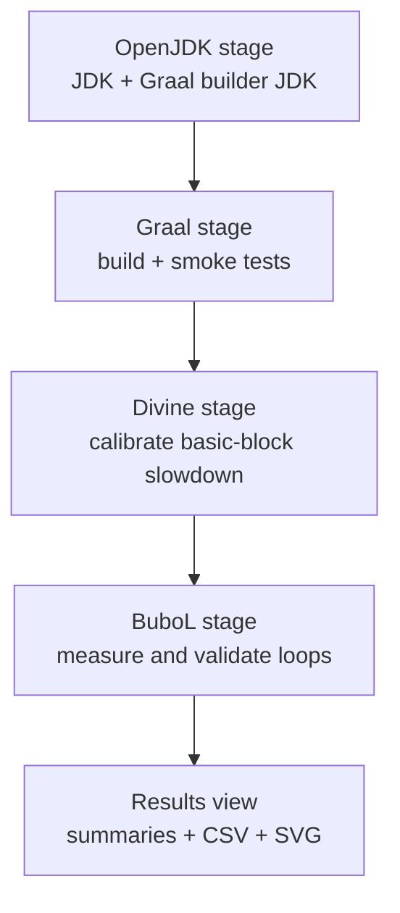

# Architecture and data flow

## Goal

CPU profilers for JIT-compiled systems are difficult to evaluate because there is
no directly observable, perfectly non-intrusive ground truth. GT Ecosystem instead
creates a controlled change in execution time: it deliberately slows selected
machine-code regions and tests whether the measured system reports the expected
change at the correct location.

The system combines two ideas:

- **Divining** searches for the amount of extra machine-code work needed to produce
  a target slowdown for each relevant basic block.
- **BuboL** places cycle-counting probes around loops late in the compiler pipeline,
  after the major optimisations whose decisions should remain undisturbed.

VTune supplies the current hardware-derived baseline. It is an approximation of
ground truth, not a claim that VTune is itself perfectly accurate.

## Components

| Component | Responsibility |
| --- | --- |
| GT-Ecosystem | Installation, orchestration, isolation, validation, and reporting |
| labs-openjdk-jvmci | Modified JVMCI-capable OpenJDK and compiler-marker support |
| graal-instrumentation | Graal phases for markers, slowdown, compiler replay, and BuboL probes |
| GTSlowdownSchedular | VTune-driven slowdown search and experiment coordination |
| are-we-fast-yet | Deterministic Java benchmarks, Async-profiler, and TSC support |
| BuboExperiments | Supporting experiment code and data |

The component repositories are pinned inputs. The ecosystem scripts build or run
them but do not change their Git history.

## Pipeline



### 1. OpenJDK

The first stage configures and builds the modified OpenJDK release image and a
`graal-builder-jdk`. A malformed generated configure cache from an interrupted run
is detected, removed, and generated once more. The resulting images are verified by
running their Java tools.

### 2. Graal

Graal is built with `mx --env libgraal` against the builder JDK. The stage repairs
`vm/latest_graalvm_home`, verifies the generated VM, checks that the expected Bubo
compiler class is present, and executes four configurations:

1. clean GraalVM;
2. GT options enabled;
3. BuboL enabled, checking non-zero encodings, loop records, and cycles; and
4. GT marker debug with Async-profiler, checking that compiler markers are visible
   in sampled stacks.

These are compiler integration smoke tests using Bounce and Sieve. The Async run is
not the full profiler-accuracy experiment from the OOPSLA paper.

### 3. Divine

For each configured benchmark, the Ground Truth Scheduler performs the preamble and
divining work needed to produce:

- a final per-block slowdown configuration;
- a compiler replay directory that stabilises compilation decisions; and
- the VTune-derived data used during calibration.

The verifier then runs the same replay twice: once normally and once with the
slowdown configuration. The ratio

```text
slowdown average run time / normal average run time
```

must fall within the benchmark's configured tolerance around the requested ratio.

### 4. BuboL

The BuboL stage repeats generation with loop instrumentation enabled. It validates
both the whole-program slowdown and the presence of usable loop-cycle data. A
separate CFG debug run maps Graal blocks to loops, and the scheduler produces a
VTune block report. The Python analyser combines:

- Graal CFG and loop membership;
- marker-to-native-block mappings;
- VTune baseline and slowdown timings; and
- normal and slowed BuboL cycle measurements.

For every qualifying loop, it records the VTune slowdown, BuboL slowdown, and
absolute percentage-point difference. The stage fails if the median difference is
above `BuboLMaxMedianDifferencePoints`.

## Measurement controls

Compiler builds are not Denoised. All benchmark executions except the initial clean
GraalVM smoke test are wrapped with the same CPU controls:

- disable Intel Turbo Boost;
- select the performance governor;
- raise process priority;
- shield benchmark cores when the host cgroup implementation permits it; and
- preserve VTune's perf settings.

The wrapper snapshots and restores the original machine state for every command.
No sudo-refresh process runs alongside a measurement.

## Run isolation and publication

Each invocation creates a new timestamped root containing two deliberately separate
views:

- `pipeline/` is mutable backend state consumed by later stages;
- `results/` is a published, read-only-in-principle view for humans and analysis.

No stage reads from `results/`. It can therefore be copied, archived, or removed
without changing the semantics of a completed pipeline.
